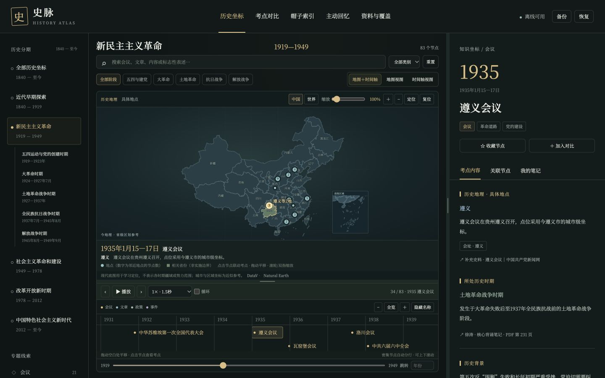

# 史脉 · 近现代史复习助手

将会议、文章、政策与历史时期放在同一张可交互地图和时间轴上，帮助梳理考研政治中的毛中特、近代史纲要，以及新思想里的历史性会议与文献。

当前版本：**1.6.1**。项目采用原生 HTML、CSS 和 JavaScript，无网页运行依赖，支持离线使用。



## 开始使用

下载项目并解压，双击 **史脉.html** 即可使用；macOS 也可以双击 **打开史脉.command**。界面调用本机已安装的思源宋体，字体文件没有随仓库分发。

需要开发预览时，在项目目录运行：

```sh
npm start
```

然后打开 <http://127.0.0.1:18740>。开发预览需要安装 Node.js；直接打开单文件版不需要。

## 主要功能

- **地图与时间轴联动**：按历史时期、革命阶段、类别和关键词筛选，拖动进度条时实时切换地点与详情，支持自动播放、调速、循环、地图缩放与平移。
- **会议与文献对应**：把大革命、土地革命、抗日战争、解放战争等阶段与相关会议、文章及具体考点结合起来阅读。
- **专题对比**：比较会议内容、历史背景、意义和易混点；土地政策单独比较“耕者有其田”、废除封建土地剥削制度、富农态度与土地所有制。
- **主动回忆与复习记录**：支持帽子表述、年份、事件排序练习，以及笔记、收藏、复习进度与备份恢复。
- **可调整布局**：地图与时间轴、主区与详情区之间的分隔条可拖动，布局在当前浏览器中保存。

知识库当前包含 **179 个节点、269 条帽子表述、40 个对比专题和 255 页相关来源提取文本**。覆盖数量说明当前整理范围，不代表已经逐项认证正式考试大纲；识别文字和细节仍应结合原书核对。

## 资料与本地数据

资料来源包括《2027核心背诵笔记》以及腿姐《2027考研政治冲刺背诵手册》上、下册，结构化节点中保留 PDF 页序，官方补充史料另列链接。原始 PDF 未包含在仓库中；如需使用“打开原 PDF”，请按 [使用说明](使用说明.md) 将自己持有的对应文件放入 `sources/` 目录。

笔记、收藏和复习状态仅保存在当前浏览器中，不会提交到 GitHub。请固定使用同一浏览器和打开方式，并定期通过应用内“备份”导出记录。

地图使用现代地理作学习定位，省份高亮表示节点关联，不代表历史疆域或政策实际实施边界。底图来源见 [data/map-source.json](data/map-source.json)。

## 修改与验证

主要数据位于 `data/`，入口为 `index.html`，交互逻辑位于 `app.js`；`map.js`、`playback.js` 和 `panels.js` 分别负责地图、播放与面板调整。

修改源文件后重新生成离线单文件版：

```sh
python3 build.py
```

运行检查：

```sh
npm test
```

更详细的使用方法与内容边界见 [使用说明](使用说明.md)、[内容覆盖与校对说明](内容覆盖与校对说明.md) 和 [下册增补核对报告](下册增补核对报告.md)。
